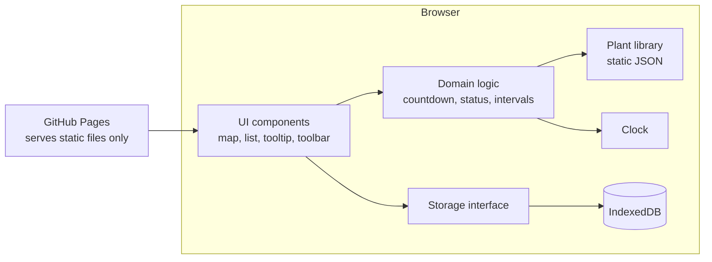
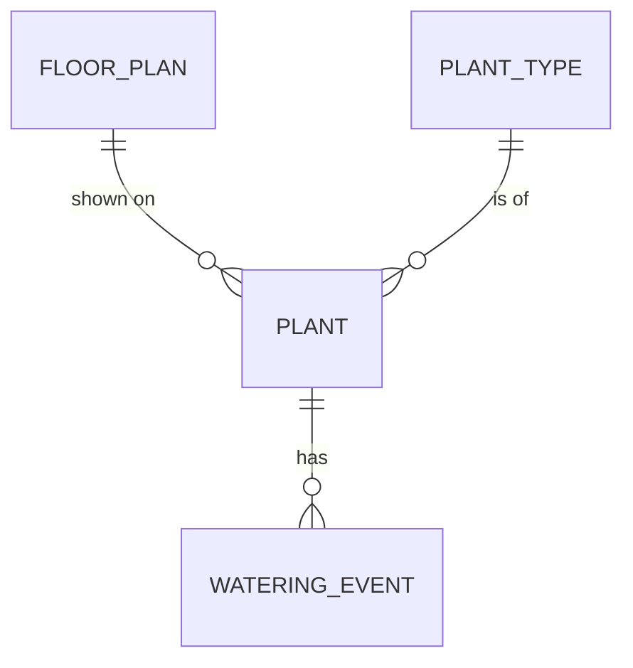
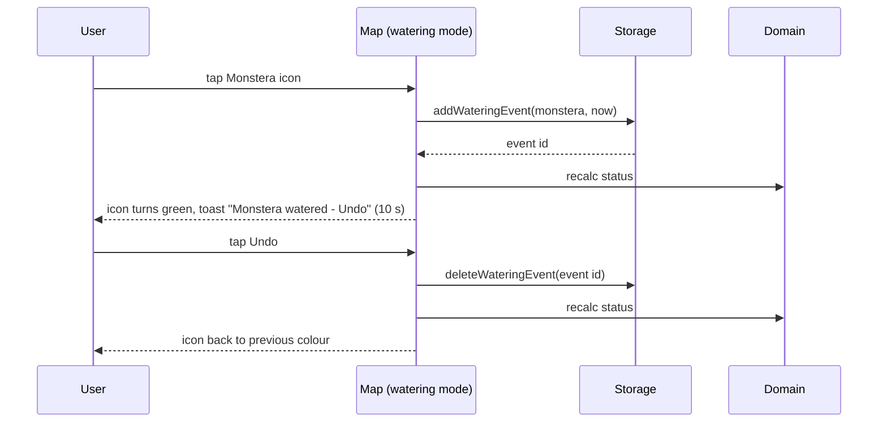

# Architecture and design

> Diagrams for everything in this document: [`docs/diagrams/`](diagrams/README.md).

## 1. Overview
A static single-page web app, written in TypeScript, hosted on GitHub Pages. There is no backend: all data lives in the browser's IndexedDB on the device that uses it.

Later (not in pilot): `ST` gets a second implementation that talks to a server on a Raspberry Pi. Nothing else changes.

## 2. Technology
| Concern | Choice | ADR |
|---|---|---|
| Language | TypeScript (strict) | 0002 |
| Build | Vite | 0002 |
| UI | React | 0002 |
| Storage | IndexedDB via `idb` wrapper | 0003 |
| Unit/component tests | Vitest + Testing Library + fake-indexeddb | 0002 |
| End-to-end tests | Playwright | 0002 |
| Hosting | GitHub Pages, deployed by GitHub Actions | 0004 |

## 3. Layers and rules
| Layer | Folder | Rules |
|---|---|---|
| Domain | `src/domain/` | Pure functions, no React, no storage, no `Date.now()`. Countdown, status, effective interval. 100% unit tested. |
| Storage | `src/storage/` | Implements the storage interface. Only layer that touches IndexedDB. |
| Data | `src/data/` | Static plant library JSON. |
| UI | `src/ui/` | React components. Calls domain for calculations, storage for persistence. |
| App | `src/app/` | Wiring: picks storage implementation, provides clock. |

Dependency direction: UI -> Domain, UI -> Storage, Domain -> nothing (except library data types).

## 4. Data model

| Entity | Fields |
|---|---|
| FloorPlan | `id` (single record "main"), `image` (Blob), `mimeType`, `widthPx`, `heightPx`, `uploadedAt` |
| PlantType | from library: `id`, `name`, `nameDa`, `baseIntervalDays`, `lightPreference`, `waterFraction`, `winterRest`, `outdoorOk`, `icon`, `careNote`, `sources` |
| Plant | `id` (UUID), `typeId`, `name`, `position {x, y}` (0..1), `spotLight`, `potDiameterCm`, `createdAt`, `archivedAt?` |
| WateringEvent | `id` (UUID), `plantId`, `wateredAt` (ISO 8601), `source` ("manual"; "sensor" reserved for later) |

Exact types: `specs/001-map-and-plants/contracts/storage-interface.md`.
Removing a plant archives it (sets `archivedAt`) so history is kept (Constitution III); archived plants are hidden from map and list.

## 5. Key calculations (domain layer)

All factors live in `src/domain/config.ts`. See ADR 0005 for the rationale.

**Season** from the local date (northern hemisphere): spring Mar-May, summer Jun-Aug, autumn Sep-Nov, winter Dec-Feb.

| Factor | sun | bright | shade |
|---|---|---|---|
| Light, interval | 0.75 | 1.0 | 1.3 |
| Light, amount | 1.1 | 1.0 | 0.9 |

| Factor | spring | summer | autumn | winter | winter, `winterRest` types |
|---|---|---|---|---|---|
| Season, interval | 1.0 | 0.85 | 1.15 | 1.4 | 2.0 |
| Season, amount | 1.0 | 1.15 | 0.9 | 0.75 | 0.75 |

**Effective interval** = `max(1, round(baseIntervalDays x lightInterval(spotLight) x seasonInterval(season, winterRest)))`

**Water amount (ml)** = `max(50, roundTo50(potVolumeL x waterFraction x lightAmount(spotLight) x seasonAmount(season) x 1000))`, where `potVolumeL = potDiameterCm³ / 2000`. Shown as "250 ml" below 1000 ml, else "1.7 L".

**Which season counts**: the next due date is calculated with the season *on the day of the last watering*. A countdown never jumps at a season boundary; the new season applies from the next watering. The water amount shown uses *today's* season.

**Next due** = calendar date of last watered + effective interval days.
**Days left** = next due - today (calendar days, local time zone).
**Status**: `due` if days left <= 0; `soon` if 1-2; `ok` if >= 3.
**Never watered**: when adding a plant, the user gives "last watered" (default: today), so every plant has at least one watering event.

**Worked example** (today Wed 4 Nov 2026, autumn): Monstera, base 7, sun spot, 24 cm pot, water fraction 0.25, last watered Thu 29 Oct.
Interval 7 x 0.75 x 1.15 = 6.04 -> 6 days; next due 4 Nov -> "today".
Amount 24³/2000 = 6.91 L x 0.25 x 1.1 x 0.9 = 1.71 L -> 1700 ml -> "1.7 L".

## 6. Sequence: tap to water

## 7. Non-functional requirements (system-wide)
| ID | Requirement |
|---|---|
| NFR-SYS-001 | No personal data in the repo or sent over the network (Constitution I). |
| NFR-SYS-002 | Usable on phone (360 px wide) and desktop. |
| NFR-SYS-003 | Every change is persisted before the UI confirms it. |
| NFR-SYS-004 | App loads in under 2 s on a normal home connection; works offline after first load is a nice-to-have. |
| NFR-SYS-005 | Accessible: icons have labels, status is not shown by colour alone (text in list and tooltip), keyboard usable on desktop. |
| NFR-SYS-006 | Floor plan images up to 10 MB accepted (PNG, JPEG, WebP). |

## 8. Assumptions and dependencies
- Everyone in the apartment uses the same device during the pilot (e.g. a shared tablet or laptop).
- The browser does not clear site data on its own; mitigated by export (feature 003) and requesting persistent storage (`navigator.storage.persist()`).
- Plant library intervals are general guidance, not botanical truth; the user can choose another type if one feels wrong.

## 9. Risks and trade-offs
| Risk / trade-off | Impact | Mitigation / why accepted |
|---|---|---|
| Browser data cleared (private mode, cleanup tools) | All data lost | Persistent storage request, export/import, reminder to export if last export > 30 days |
| Single device only | Others must use the same device | Accepted for pilot; Pi server later via storage interface |
| Hover does not exist on touch screens | Plant info hard to reach on phone | Info also shown in the list row and in edit mode (see `docs/ui.md`) |
| Tap waters instantly, so accidental taps happen | Wrong watering logged | Undo toast; double-tap within 60 s ignored |
| Season factors are coarse (4 steps, no weather) | Slightly too much or little water around season changes | Factors in one config file; tune after a few weeks; sensors later replace guessing |
| Pot volume formula is an estimate | Amount off for unusual pot shapes | Amount is guidance; user can pick a nearby pot size |
| Public GitHub Pages site | Anyone can open the URL | Site contains no data; each visitor sees an empty app |

## 10. Path to the ERP
- Glossary and entities match ERP spec `004-plant-care`.
- Export file (`specs/003-backup-export/contracts/export-format.md`) is the migration path into the ERP.
- `WateringEvent.source` already reserves `"sensor"` for ERP `005-sensor-ingestion`.
