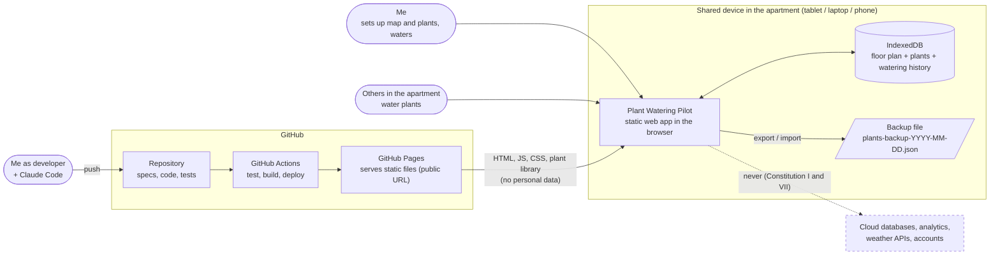

# 01 - System context

The app is a static website. Everything personal stays in the browser of one shared device in the apartment. GitHub only serves code.

Key points for implementation:
- No request ever leaves the browser except loading the app itself from GitHub Pages.
- The floor plan image is uploaded by the user into IndexedDB; it is never part of the repo or the build.
- Anyone can open the public URL but sees an empty app, because data is per browser.
