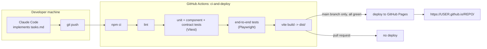
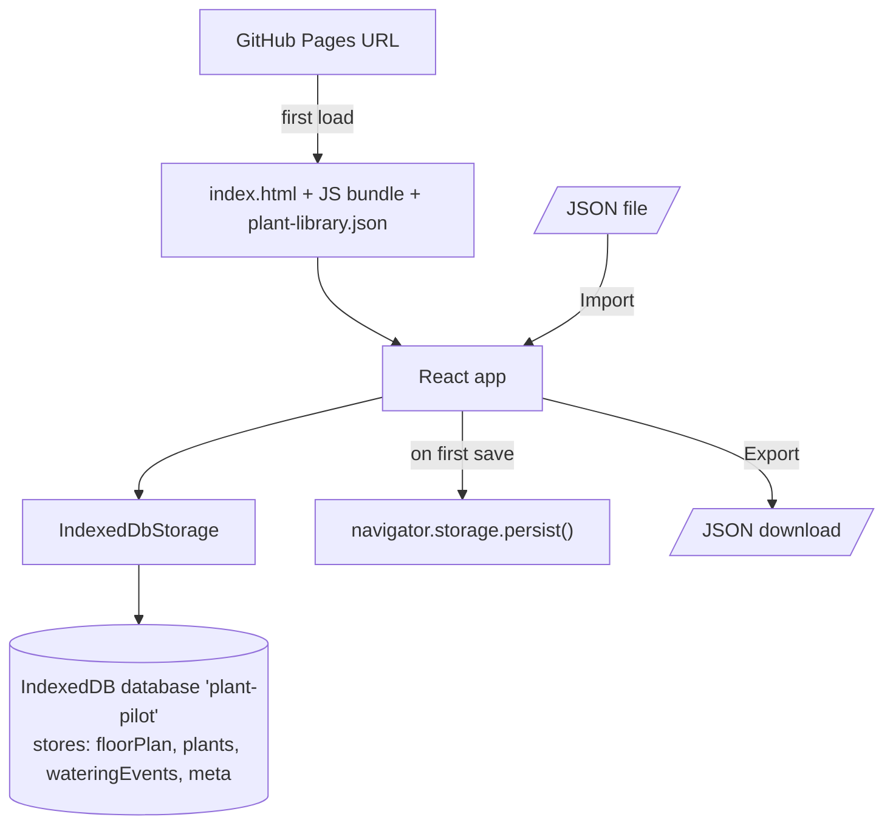

# 02 - Build, deploy and runtime

## Pipeline

## Runtime in the browser

Notes:
- Vite `base` must equal `/<repo-name>/` for Pages.
- No client-side routing with paths (Pages would 404 on refresh); single screen or hash only.
- IndexedDB object stores and their keys are defined in `src/storage/` and nowhere else.
