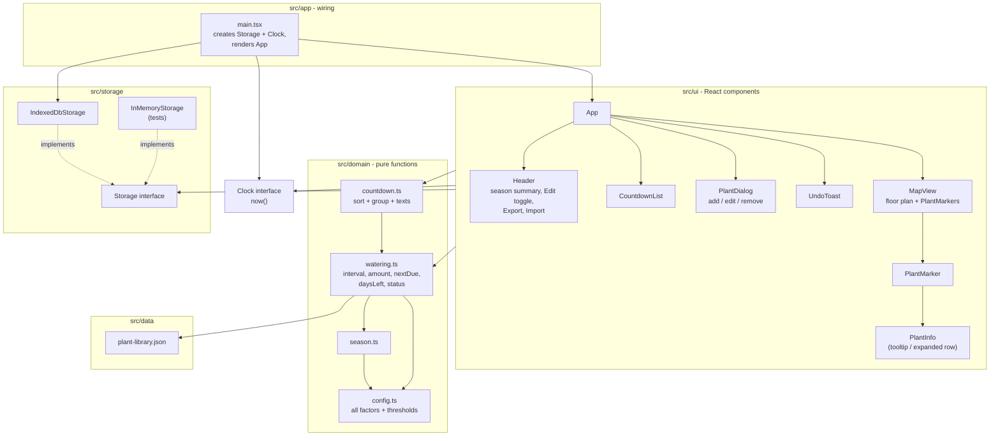

# 03 - Layers and dependency rules

## Rules (enforce with lint rules / review)

| From | May import | Must NOT import |
|---|---|---|
| `src/domain` | `src/domain`, types from `src/data` | React, `src/storage`, `src/ui`, `Date.now()` / `new Date()` without argument |
| `src/storage` | `src/domain` types | React, `src/ui` |
| `src/ui` | `src/domain`, `Storage` interface, `Clock` | `IndexedDbStorage` directly, `indexedDB` API |
| `src/app` | everything | - |

Why: domain stays 100% unit-testable with a fixed clock (Constitution V); storage can be swapped for the Pi server by changing only `src/app` (Constitution II, diagram 08).
