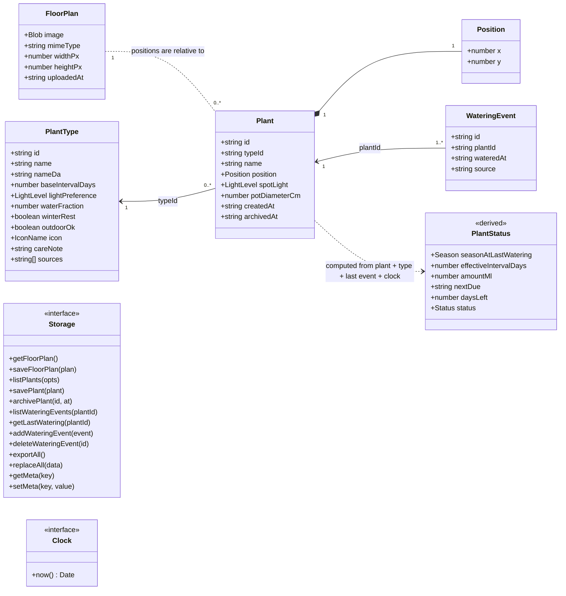
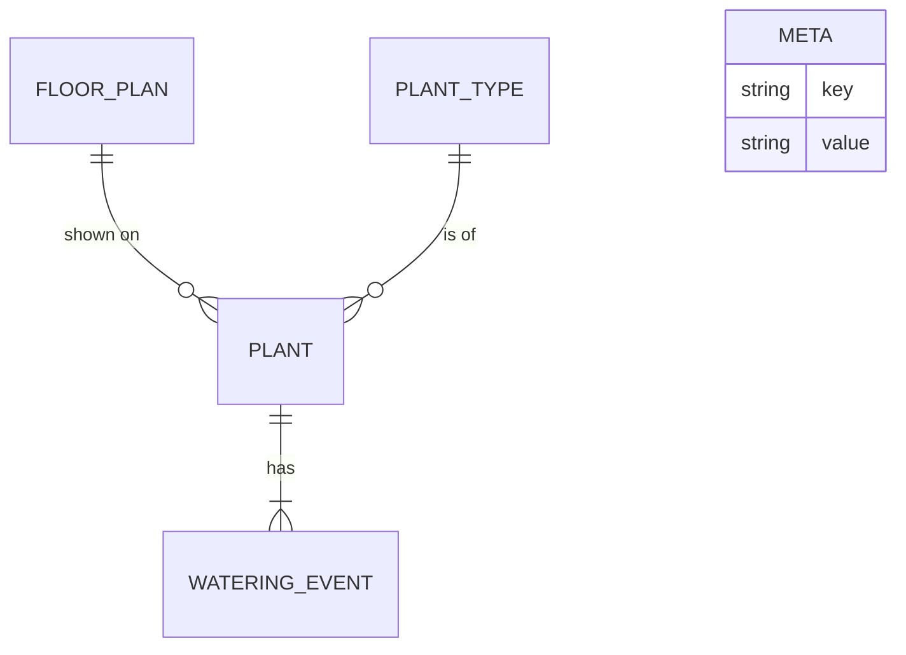

# 04 - Domain model

## Types (TypeScript, see contracts for exact definitions)

## Storage view

Rules:
- `Position.x`/`y` are 0..1 relative to the image. `WateringEvent.source` is `manual` or `sensor` (reserved). `PlantStatus.status` is `ok`, `soon` or `due`.
- `PlantType` lives in `plant-library.json`, never in IndexedDB. Plants reference it by `typeId`.
- `PlantStatus` is always computed, never persisted; recomputed on every render, at midnight, and on focus.
- Removing a plant sets `archivedAt`; watering events are kept.
