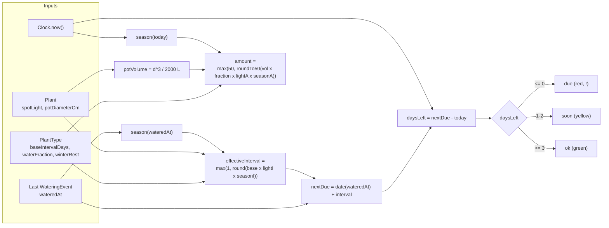
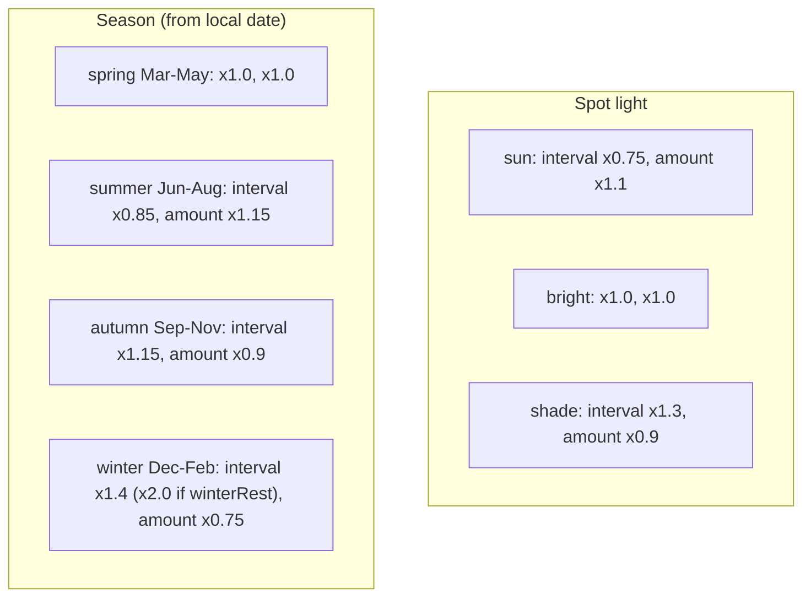
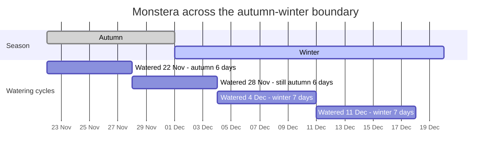

# 05 - Watering model

Exact factors: `docs/architecture.md` section 5 and `src/domain/config.ts`.

## Calculation flow

Note the two different seasons: the **interval** uses the season at the last watering (so countdowns never jump), the **amount** uses today's season (so the advice is current).

## Factor tables

## Season boundary example

Monstera, base 7, sun spot. Autumn interval = 6 days, winter interval = 7 days.

The cycle starting 28 Nov keeps its autumn interval even though it ends in winter (spec 002, story 5, scenario 2).
