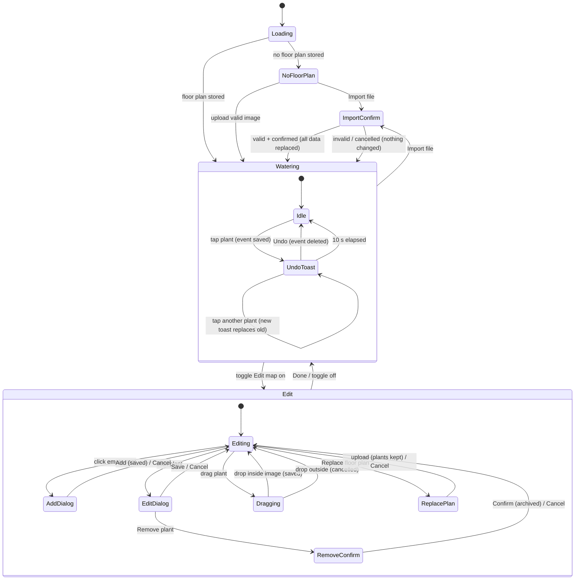
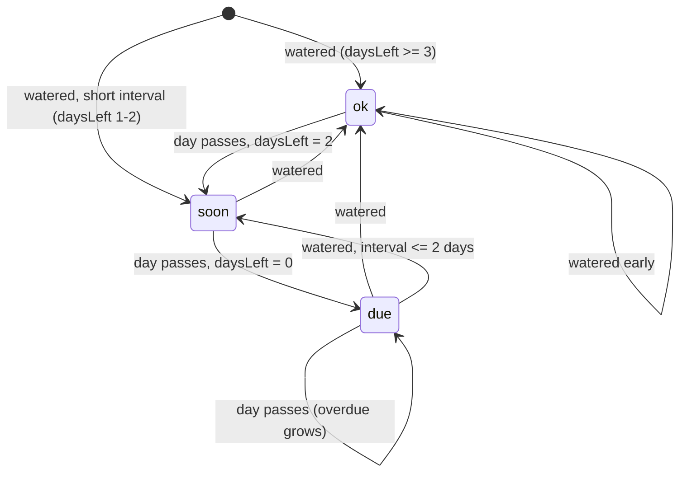

# 06 - UI states

## App modes

## What a pointer action on a plant does

| Action | Watering mode | Edit mode |
|---|---|---|
| Tap / click plant | Water it + undo toast (ignored if watered < 60 s ago) | Open edit dialog |
| Hover / keyboard focus | Show plant info tooltip | Show plant info tooltip |
| Drag plant | Nothing | Move it |
| Click empty map | Nothing | Open add dialog at that spot |
| Tap list row | Expand plant info + Water button | Expand plant info |

## Plant status over time

