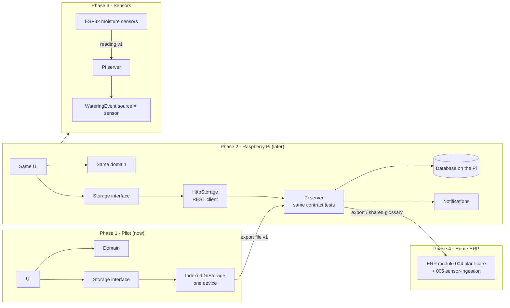

# 08 - Evolution path

Why the storage interface exists: each later step replaces or adds one piece, and the domain and UI stay as they are.

## What changes at each step

| Step | Added | Replaced | Unchanged |
|---|---|---|---|
| Pilot -> Pi | `HttpStorage`, Pi server, notifications | storage selection in `src/app` | domain, UI, export format |
| Pi -> Sensors | ingestion on the Pi, firmware | - | `WateringEvent` (source `sensor` already reserved) |
| -> ERP | plant becomes an ERP inventory item | pilot app shell | glossary terms, watering model, export file as migration |

Design decisions taken now so these steps stay cheap: Constitution II (storage interface), VI (ERP glossary), versioned export format, `source` field on watering events.
