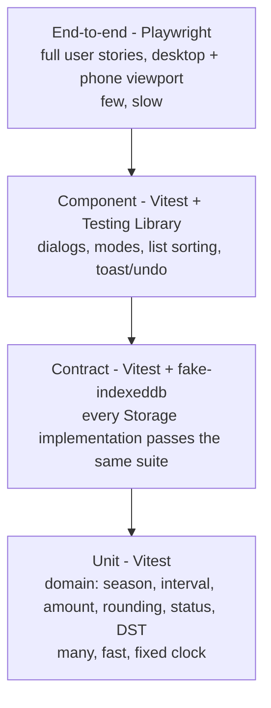
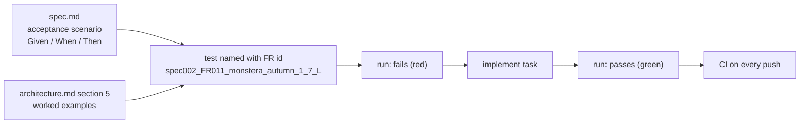

# 09 - Test strategy

## Which layer is tested how

## From spec to test

## Ready-made unit test cases (fixed clock: Wed 4 Nov 2026, autumn)

| Case | Expected |
|---|---|
| Pothos base 7, bright, last 1 Nov | interval 8, due 9 Nov, "in 5 days", ok |
| Monstera base 7, sun, last 29 Oct | interval 6, due today, due |
| Basil base 2, sun, last 1 Nov | interval 2, overdue 1 day, due |
| Peace lily base 5, shade | interval 7 |
| Monstera 24 cm, fraction 0.125, sun, autumn | 850 ml |
| Same Monstera in summer / winter | 1100 ml ("1.1 L") / 700 ml |
| Basil 12 cm, fraction 0.15, sun, autumn | 150 ml |
| Cactus 10 cm, fraction 0.05, bright, winter | 50 ml (minimum) |
| Cactus base 21, bright, winterRest, winter / summer | 42 days / 18 days |
| Monstera sun watered 28 Nov | due 4 Dec (autumn interval kept) |
| Tap twice within 60 s | one event |
| Rounding 6.5 / 1.5 | 7 / 2 |
